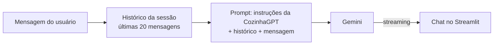

# 🍳 CozinhaGPT

**CozinhaGPT** é um assistente virtual de culinária desenvolvido em Python. Ele utiliza Inteligência Artificial para sugerir receitas criativas, práticas e personalizadas com base apenas nos ingredientes que o usuário possui em casa.

A aplicação possui uma interface de chat construída com **Streamlit** e utiliza **LangChain** para montar o prompt com a memória da conversa e conversar com o **Gemini** (plano gratuito da API do Google).

> 📸 _Coloque aqui um print ou GIF de uma conversa._

---

## ✨ Funcionalidades

- **Geração de receitas por ingredientes:** informe o que tem na geladeira e receba sugestões viáveis, com tempo, dificuldade e substituições.
- **Memória de conversa:** o assistente lembra do contexto (ex.: se você disse que não gosta de cebola no início, ele evita nas próximas sugestões).
- **Adaptação a restrições alimentares:** sugestões para dietas veganas, sem glúten ou sem lactose.
- **Lista de compras:** ao final de cada receita, mostra o que falta comprar.
- **Resposta em tempo real:** a receita aparece enquanto é escrita (streaming).
- **Nova conversa:** botão para recomeçar do zero.

---

## 🧠 Como funciona



- O histórico de cada aba do navegador fica na sessão do Streamlit e entra no prompt por um `MessagesPlaceholder`.
- Só as últimas 20 mensagens vão para o modelo, para manter custo e velocidade sob controle em conversas longas.

---

## 🛠️ Tecnologias Utilizadas

- [Python 3.x](https://www.python.org/)
- [Streamlit](https://streamlit.io/)
- [LangChain](https://www.langchain.com/)
- [Gemini API](https://ai.google.dev/) – modelo `gemini-3.8-flash` (plano gratuito)

---

## 🚀 Como Rodar o Projeto

### ⚙️ Pré-requisitos
Uma chave da Gemini API, gratuita e sem cartão: [aistudio.google.com/apikey](https://aistudio.google.com/apikey).

### 📦 Instalação

1. Clone este repositório:

   ```bash
   git clone https://github.com/LeonhardtBN/cozinhagpt.git
   cd cozinhagpt
   ```

2. Crie um ambiente virtual (opcional, mas recomendado):

   ```bash
   python -m venv venv

   # No Windows:
   venv\Scripts\activate

   # No Linux/Mac:
   source venv/bin/activate
   ```

3. Instale as dependências:

   ```bash
   pip install -r requirements.txt
   ```

4. Copie o `.env.example` para `.env` e coloque sua chave:

   ```bash
   GEMINI_API_KEY=sua-chave-aqui
   ```

5. Execute a aplicação:

   ```bash
   streamlit run app.py
   ```

### 🧪 Testes

```bash
pytest -q
```

Os testes rodam sem chave de API, com um modelo falso no lugar do Gemini. Eles conferem a saudação, a memória de conversa (sem duplicar o histórico no prompt) e o botão de nova conversa.

---

## 📂 Estrutura do Projeto

```text
cozinhagpt/
├── app.py            # Código principal da aplicação Streamlit
├── tests/            # Testes automatizados
├── .env.example      # Modelo das variáveis de ambiente
├── requirements.txt  # Dependências do projeto
└── README.md         # Documentação
```

---

## 🤝 Contribuição

Contribuições são bem-vindas! Sinta-se à vontade para abrir **issues** ou enviar **pull requests** com melhorias na interface ou nas instruções do prompt.

---

## 📝 Licença

Este projeto está sob a licença **MIT**. Consulte o arquivo `LICENSE` para mais detalhes.
